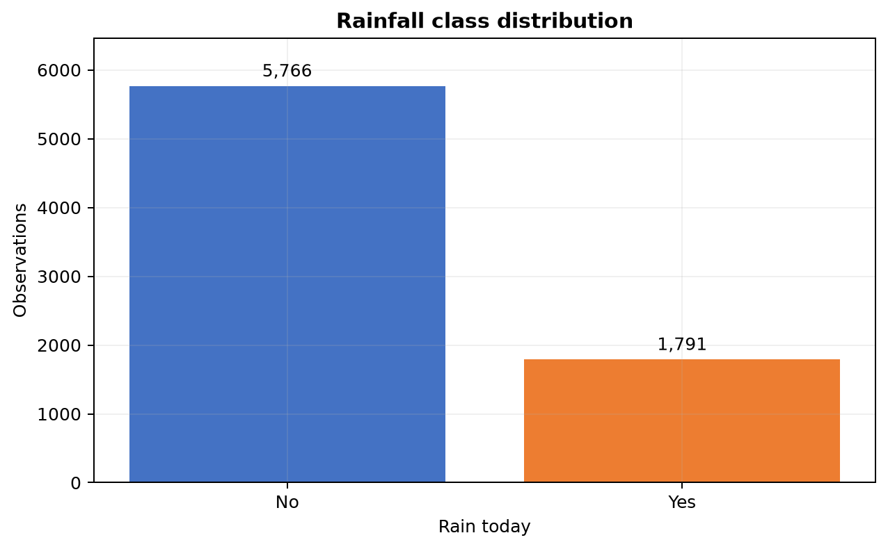
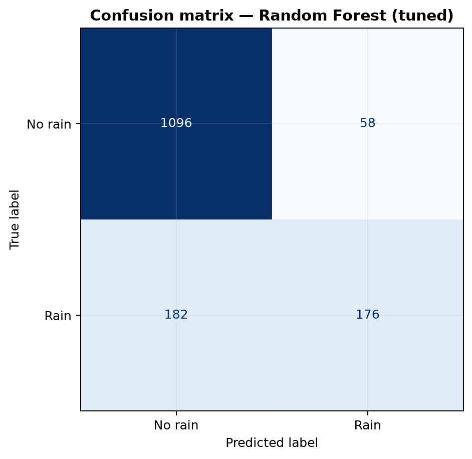
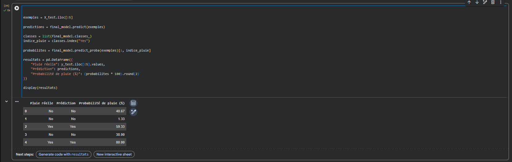
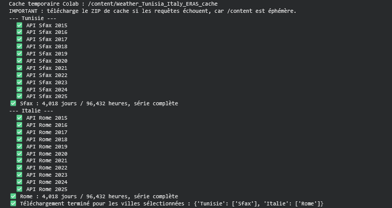
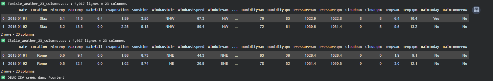
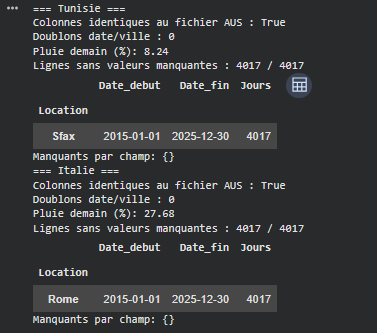
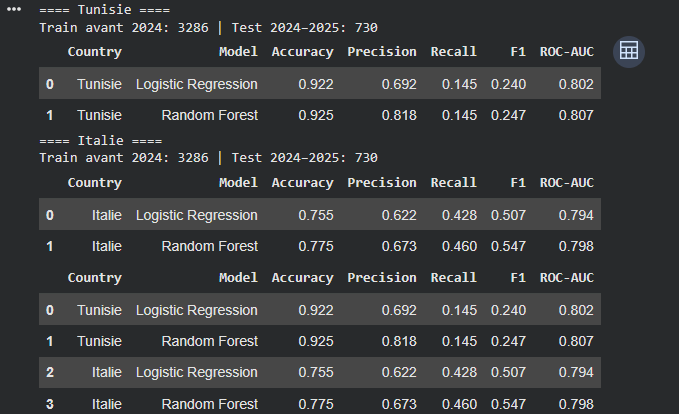
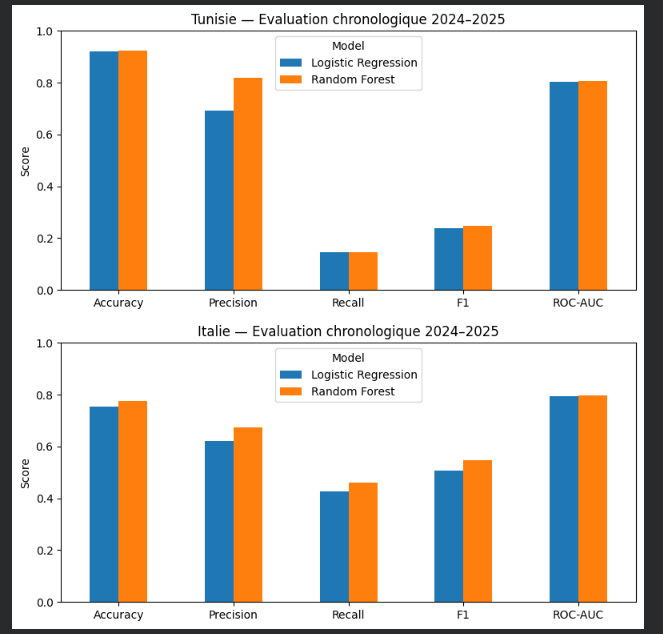
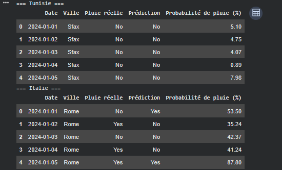

# Rainfall Prediction with Machine Learning

This student project explores next-day rainfall classification with historical weather data from Australia, Tunisia, and Italy. It combines an IBM/Coursera Australian coursework project with later experiments for Sfax and Rome using Open-Meteo ERA5 reanalysis.

The three experiments share a general machine learning workflow, but they use different data sources and evaluation designs. Their scores should be read independently, not as a country ranking or as evidence of an operational weather forecasting system.

## Contents

- [Background and objectives](#background-and-objectives)
- [Datasets and geographical coverage](#datasets-and-geographical-coverage)
- [Technologies](#technologies)
- [Methodology](#data-preparation-and-machine-learning-methodology)
- [Australia experiment](#experiment-a--australia)
- [Tunisia experiment](#experiment-b--tunisia)
- [Italy experiment](#experiment-c--italy)
- [Evaluation](#model-evaluation-and-comparison)
- [Execution screenshots](#real-execution-screenshots)
- [Run in Google Colab](#run-the-notebooks-in-google-colab)
- [Run locally](#optional-local-execution)
- [Limitations](#project-limitations)
- [Sources and acknowledgments](#sources-academic-acknowledgments-and-author)

## Background and objectives

The Australian work began with the final project from IBM's *Machine Learning with Python* course on Coursera. The preserved course notebook was then extended with reproducible scikit-learn pipelines, additional evaluation metrics, figures, and a saved model.

The later Sfax and Rome experiments ask a related learning question: how does the same general classification approach behave when it is rebuilt on historical data from different climates? Each location receives its own model and chronological evaluation. The Australian trained model is not reused for Tunisia or Italy.

The project objectives are to:

- prepare daily weather features for next-day rain classification;
- prevent direct target and preprocessing leakage;
- compare Logistic Regression and Random Forest models;
- evaluate the rainy class with precision, recall, F1, and ROC-AUC instead of accuracy alone;
- document data provenance, approximations, imbalance, and reproducibility limits.

## Datasets and geographical coverage

| Experiment | Locations | Source and period | Evaluation design |
|---|---|---|---|
| Australia | Melbourne, Melbourne Airport, Watsonia | Australian weather observations packaged for the IBM course; local file spans 2007–2017 | Reproducible random stratified 80/20 holdout and shuffled stratified CV |
| Tunisia | Sfax | Open-Meteo Historical Weather API, ERA5, 2015–2025 | Train through 30 Dec 2023; chronological test from 1 Jan 2024 to 30 Dec 2025 |
| Italy | Rome | Open-Meteo Historical Weather API, ERA5, 2015–2025 | Train through 30 Dec 2023; chronological test from 1 Jan 2024 to 30 Dec 2025 |

The Australian CSV has 145,460 rows and 23 columns. After complete-case filtering and the three-location filter, 7,557 rows remain for modeling. The Sfax and Rome executions each produced 4,017 labeled rows and used the same 23 column names.

Those matching names do not make the physical measurements identical. The Open-Meteo files contain several approximations: `Evaporation` is FAO reference evapotranspiration, `WindGustDir` is inferred from the hour of the largest modeled gust, and cloud percentages are converted approximately to octas. ERA5 is gridded reanalysis rather than a dedicated station record. See [data/README.md](data/README.md) for the complete mapping and provenance notes.

## Technologies

- Python, NumPy, and Pandas
- scikit-learn pipelines, preprocessing, Logistic Regression, and Random Forest
- Matplotlib
- Jupyter Notebook and Google Colab
- joblib for the saved Australian pipeline
- Requests and the Open-Meteo Historical Weather API

## Data preparation and Machine Learning methodology

All experiments are binary classifications of whether the next day is rainy.

For Australia, the original `RainTomorrow` label becomes the modeling target. The extension renames original `RainToday` to `RainYesterday` and original `RainTomorrow` to `RainToday` to follow the course convention. Rows containing missing values are removed before the Melbourne-area location filter. Numeric features are standardized, categorical features are one-hot encoded, and preprocessing is fitted inside each training pipeline.

For Sfax and Rome, `RainToday` is `Yes` when daily precipitation is strictly greater than 1.0 mm. `RainTomorrow` is created by shifting that label one calendar day forward within the same city. The last day is removed because it has no next-day label. `Date` and `RainTomorrow` are excluded from predictors. Missing-value imputation, scaling, and one-hot encoding are fitted only on the pre-2024 training period.

The multi-country notebook downloads one city-year at a time and caches successful responses. On HTTP 429 it stops, creates a recoverable cache archive, and asks the user to resume later instead of repeatedly calling the API.

## Experiment A — Australia

The Australian extension compares a majority-class baseline, baseline Logistic Regression and Random Forest models, and compact tuned versions of both classifiers. Five-fold shuffled `StratifiedKFold` cross-validation optimizes ROC-AUC on the training data. Random Forest is selected from the tuned candidates using the cross-validation score before final test metrics are inspected.

Verified held-out results for the selected tuned Random Forest:

| Accuracy | Precision | Recall | F1 | ROC-AUC |
|---:|---:|---:|---:|---:|
| 84.13% | 75.21% | 49.16% | 59.46% | 0.885 |

The confusion matrix is `[[1096, 58], [182, 176]]` in actual/predicted class order `No, Yes`. These values were independently reproduced from the tracked `models/rainfall_classifier.joblib`, the local source CSV, and the deterministic split recorded in [results/metrics.json](results/metrics.json).

The random split supports comparison with the course workflow, but neighboring weather observations can be temporally correlated. It should not be described as a chronological deployment test.



*The Australian modeling subset contains 5,766 non-rain and 1,791 rain labels, so minority-class metrics are necessary.*



*The selected model misses 182 of 358 rainy test observations, which explains the 49.16% rain recall.*

## Experiment B — Tunisia

The Tunisia experiment trains new models on Sfax ERA5-derived data. The supplied execution reports an 8.24% next-day rain rate and no missing values in the generated 4,017-row table. Its chronological test contains 730 rows from 2024–2025.

Results displayed in the supplied Colab execution:

| Model | Accuracy | Precision | Recall | F1 | ROC-AUC |
|---|---:|---:|---:|---:|---:|
| Logistic Regression | 92.2% | 69.2% | 14.5% | 0.240 | 0.802 |
| Random Forest | 92.5% | 81.8% | 14.5% | 0.247 | 0.807 |

The Random Forest's high accuracy is misleading in isolation because most days are non-rainy. Recall of 14.5% means it detects only a small share of rainy days in this test period. The model should not be presented as reliable for rainfall detection.

## Experiment C — Italy

The Italy experiment separately trains models on Rome ERA5-derived data. The supplied execution reports a 27.68% next-day rain rate, no missing values in the generated 4,017-row table, and the same 730-row chronological test window.

Results displayed in the supplied Colab execution:

| Model | Accuracy | Precision | Recall | F1 | ROC-AUC |
|---|---:|---:|---:|---:|---:|
| Logistic Regression | 75.5% | 62.2% | 42.8% | 0.507 | 0.794 |
| Random Forest | 77.5% | 67.3% | 46.0% | 0.547 | 0.798 |

The Rome Random Forest detects more rainy days than the Sfax model in its own test set, but the different rain prevalence and data-generating conditions prevent a fair country performance ranking.

## Model evaluation and comparison

The Australian metrics are stored at full precision in [results/metrics.json](results/metrics.json). The Sfax and Rome values are transcribed exactly at the three-decimal precision visible in the supplied screenshot and recorded with their evidence path in [results/tunisia_italy_screenshot_metrics.csv](results/tunisia_italy_screenshot_metrics.csv).

The Sfax/Rome notebook provided in the source archive had no saved outputs. During final validation, a fresh API run retrieved every Sfax year and Rome through 2021 before Open-Meteo returned HTTP 429 for Rome 2022. The cache recovery path worked, but the full multi-country metrics were therefore not independently reproduced in that validation run. They remain clearly attributed to the supplied Colab screenshots.

The experiments should be compared only within their documented context:

- Australia uses complete cases and a random stratified holdout.
- Sfax and Rome use generated ERA5-derived features and a chronological holdout.
- Class prevalence differs substantially between locations.
- ROC-AUC measures ranking, while recall and F1 reveal the rainy-class behavior hidden by accuracy.

## Real execution screenshots

### Australian sample predictions



*Five Australian test examples show the observed label, predicted label, and estimated rain probability. They are illustrative and do not replace aggregate evaluation.*

### Open-Meteo download for Sfax and Rome



*The Colab output shows successful yearly ERA5 requests for Sfax and Rome and complete daily/hourly series for the selected cities.*

### Generated dataset preview



*The generated Sfax and Rome tables each contain 23 Australian-compatible column names. Structural compatibility does not mean physical equivalence.*

### Dataset validation



*The supplied run reports 4,017 rows per city, no duplicate date/city pairs, no displayed missing fields, and rain rates of 8.24% for Sfax and 27.68% for Rome.*

### Chronological model results



*The 2024–2025 test metrics show why accuracy alone is insufficient, especially for the strongly imbalanced Sfax target.*

### Model comparison charts



*The charts compare Logistic Regression and Random Forest within each location; they are not a country ranking.*

### Sample Sfax and Rome predictions



*Five chronological examples per location show labels and probabilities. The Rome examples include both false positives and false negatives, illustrating why a few samples cannot establish reliability.*

## Run the notebooks in Google Colab

### Australia extension

[](https://colab.research.google.com/github/Melek-Lahmar/rainfall-prediction/blob/main/rainfall_prediction.ipynb)

1. Open the [Australia extension directly in Google Colab](https://colab.research.google.com/github/Melek-Lahmar/rainfall-prediction/blob/main/rainfall_prediction.ipynb).
2. Upload `weatherAUS_2.csv` to the Colab working directory.
3. Choose **Runtime → Run all**.

The Australian CSV is not committed. Obtain it from the course material or the cited dataset source and review its current terms.

### Tunisia and Italy

[](https://colab.research.google.com/github/Melek-Lahmar/rainfall-prediction/blob/main/notebooks/tunisia_italy_rainfall_experiments.ipynb)

1. Open the [Tunisia and Italy notebook directly in Google Colab](https://colab.research.google.com/github/Melek-Lahmar/rainfall-prediction/blob/main/notebooks/tunisia_italy_rainfall_experiments.ipynb).
2. Keep the default `SELECTED_CITIES` values (`Sfax` and `Rome`) for the documented experiments.
3. Choose **Runtime → Run all**.
4. If Open-Meteo returns HTTP 429, preserve `weather_cache_partial.zip`. The notebook creates it and attempts a browser download; if that download does not start, download the file from Colab's **Files** panel before ending the session. The final dataset ZIP is not created until all requested years finish successfully.
5. After the service limit has recovered, start a new Colab session, upload the archive with the exact name `weather_cache_partial.zip` into `/content`, and then choose **Runtime → Run all**. The notebook automatically restores completed yearly `.json.gz` files and requests only missing city-years.
6. After a successful complete run, download `Tunisie_Italie_2_Datasets_Meteo.zip`.

Do not repeatedly restart the notebook after a 429 response. Wait for the service limit to recover and resume from the cache.

### IBM/Coursera completed course copy

[](https://colab.research.google.com/github/Melek-Lahmar/rainfall-prediction/blob/main/FinalProject_AUSWeather_completed.ipynb)

The valid completed course copy is available [directly in Google Colab](https://colab.research.google.com/github/Melek-Lahmar/rainfall-prediction/blob/main/FinalProject_AUSWeather_completed.ipynb). The byte-for-byte archival source is preserved at [original/FinalProject_AUSWeather_original.ipynb](original/FinalProject_AUSWeather_original.ipynb); it retains legacy notebook metadata from the course distribution.

## Optional local execution

Python 3.10 or later is recommended.

```bash
git clone https://github.com/Melek-Lahmar/rainfall-prediction.git
cd rainfall-prediction
python -m venv .venv
```

Activate the environment, then install dependencies:

```bash
# Windows PowerShell
.venv\Scripts\Activate.ps1

# macOS or Linux
source .venv/bin/activate

python -m pip install -r requirements.txt
```

For Australia, place `weatherAUS_2.csv` at the repository root and run:

```bash
jupyter notebook rainfall_prediction.ipynb
# or rebuild the tracked Australian model, metrics, and figures
python scripts/build_australia_experiment.py
```

For Sfax and Rome:

```bash
jupyter notebook notebooks/tunisia_italy_rainfall_experiments.ipynb
```

Network access is required for Open-Meteo. Generated datasets, caches, and ZIP files are ignored by Git.

## Project structure

```text
.
├── README.md
├── rainfall_prediction.ipynb
├── FinalProject_AUSWeather_completed.ipynb
├── notebooks/
│   └── tunisia_italy_rainfall_experiments.ipynb
├── original/
│   └── FinalProject_AUSWeather_original.ipynb
├── assets/screenshots/
├── data/README.md
├── images/
├── models/rainfall_classifier.joblib
├── results/
│   ├── metrics.json
│   ├── model_comparison.csv
│   └── tunisia_italy_screenshot_metrics.csv
└── scripts/
    ├── build_australia_experiment.py
    └── validate_repository.py
```

## Project limitations

- This is historical next-day classification, not an operational real-time forecasting service.
- The Australian random split may overestimate performance when nearby dates are correlated.
- Complete-case filtering removes many Australian rows and may introduce selection bias.
- Sfax and Rome use ERA5 reanalysis and approximated fields that are not physically identical to the Australian measurements.
- The 1.0 mm rainfall threshold is a modeling definition and may not match other meteorological conventions.
- The Sfax target is strongly imbalanced; its high accuracy does not imply useful rain detection.
- No probability calibration, cost-sensitive threshold selection, spatial generalization, or future-climate stability study is included.
- No claim is made for cities that were configured in early notebook drafts but not verified in the supplied execution.
- Open-Meteo availability and rate limits can prevent a complete fresh run at a given time.

## Sources, academic acknowledgments and author

- IBM, *Machine Learning with Python* on Coursera — origin of the Australian course notebook and exercise structure. IBM does not endorse this repository or the later experiments.
- [Australian Bureau of Meteorology](http://www.bom.gov.au/climate/dwo/) and [Kaggle Rain in Australia](https://www.kaggle.com/datasets/jsphyg/weather-dataset-rattle-package/) — Australian data references stated in the course materials.
- [Open-Meteo Historical Weather API](https://open-meteo.com/en/docs/historical-weather-api) — access to the Sfax and Rome historical series. Attribution: Weather data by Open-Meteo.com.
- [Copernicus Climate Change Service — ERA5](https://climate.copernicus.eu/climate-reanalysis) — reanalysis background.

Author: **Melek Lahmar**
