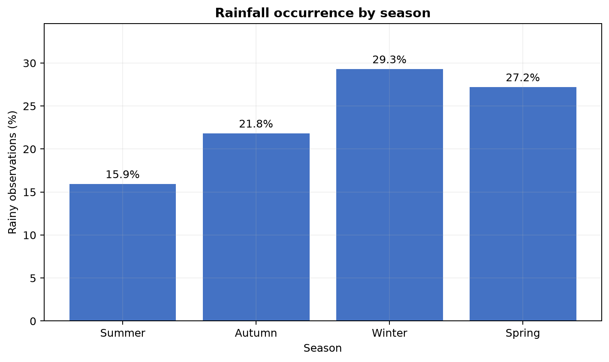
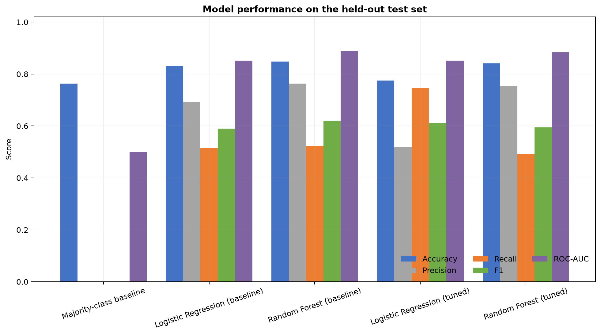
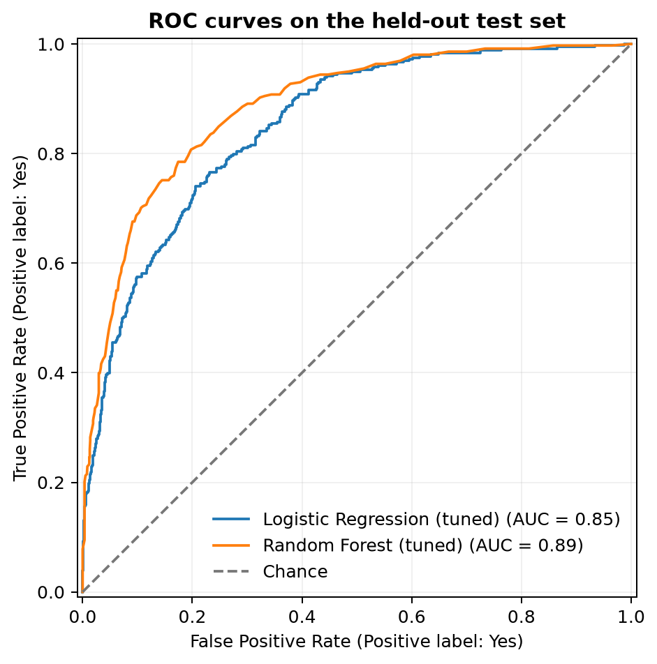
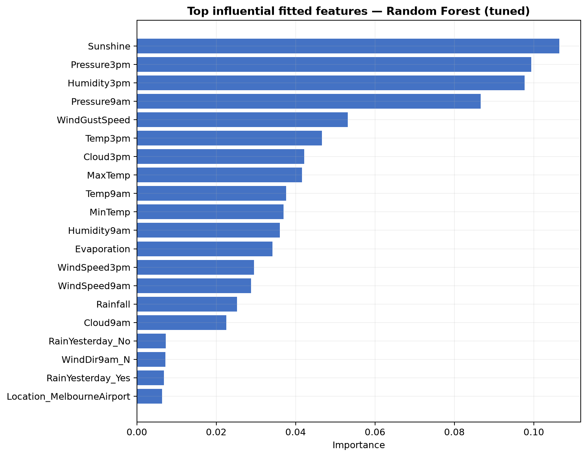

# 🌧️ Australian Rainfall Prediction using Machine Learning

## Overview

An end-to-end binary classification project that predicts rainfall for the Melbourne area from historical Australian weather observations. The repository contains an executed notebook, leakage-aware preprocessing pipelines, cross-validated model tuning, reproducible figures, and a serialized final pipeline.

## Project Context

The project originated from IBM's *Machine Learning with Python* coursework on Coursera and was independently enhanced into a portfolio project. IBM does not endorse this enhanced repository.

## Objective

Predict whether it rains on the current conceptual day using weather measurements available through the preceding day.

## Dataset

- Local file: `weatherAUS_2.csv` (intentionally ignored by Git while redistribution terms remain unclear)
- Source stated by the IBM notebook: Australian Bureau of Meteorology observations, packaged as Kaggle's *Rain in Australia* dataset
- Raw shape: **145,460 rows × 23 columns**
- Modeling sample: **7,557 complete observations**
- Geographic scope: Melbourne, Melbourne Airport, and Watsonia
- Target: `RainToday` after the IBM target-shift convention
- Positive-class rate: **23.7%**

See [data/README.md](data/README.md) for source and setup details.

## Machine Learning Workflow

Data Loading → Data Cleaning → Feature Engineering → Preprocessing → Model Training → Cross-Validation → GridSearchCV → Evaluation → Final Pipeline

## Technologies

Python, NumPy, Pandas, Matplotlib, scikit-learn, Jupyter, and joblib.

## Exploratory Data Analysis




## Data Leakage Considerations

The raw file contains `RainToday` and `RainTomorrow`. Same-day weather measurements can leak information if used to predict the original `RainToday`. Following the IBM exercise, original `RainTomorrow` becomes the modeling target `RainToday`, original `RainToday` becomes `RainYesterday`, and all other same-row weather measurements are interpreted as prior-day information. Preprocessing is fitted only inside training and cross-validation pipelines.

## Preprocessing

The course workflow removes incomplete rows. Numerical predictors are standardized, categorical predictors are one-hot encoded with unknown-category handling, and both transformations are fitted inside a `ColumnTransformer`/`Pipeline` to prevent preprocessing leakage.

## Models

- Majority-class baseline
- Logistic Regression
- Random Forest

Baseline and tuned versions of both classifiers are evaluated.

## Hyperparameter Tuning

Both classifiers use five-fold `StratifiedKFold` cross-validation. `GridSearchCV` optimizes ROC-AUC over compact, model-specific parameter grids. The selected model's best parameters are `{'classifier__class_weight': 'balanced_subsample', 'classifier__max_depth': None, 'classifier__min_samples_split': 2, 'classifier__n_estimators': 150}` and its best mean cross-validation ROC-AUC is **0.8969**.

## Results

| Model | Accuracy | Precision | Recall | F1 | ROC-AUC |
|---|---:|---:|---:|---:|---:|
| Majority-class baseline | 0.763 | 0.000 | 0.000 | 0.000 | 0.500 |
| Logistic Regression (baseline) | 0.831 | 0.692 | 0.514 | 0.590 | 0.851 |
| Random Forest (baseline) | 0.849 | 0.763 | 0.522 | 0.620 | 0.889 |
| Logistic Regression (tuned) | 0.775 | 0.517 | 0.746 | 0.611 | 0.851 |
| Random Forest (tuned) | 0.841 | 0.752 | 0.492 | 0.595 | 0.885 |

The selected model is **Random Forest (tuned)**. Its held-out confusion matrix is `[[1096, 58], [182, 176]]` for actual/predicted class order `No, Yes`.

## Model Comparison



## Confusion Matrix


## ROC Curve



## Feature Importance



The plot describes influence in the fitted model; it does not establish causality.

## Key Findings

- The retained target is imbalanced: rain occurs in **23.7%** of observations, so accuracy alone is insufficient.
- **Random Forest (tuned)** had the strongest mean cross-validated ROC-AUC among the tuned candidates and was selected before inspecting final test metrics.
- Tuned Logistic Regression detected more rainy days on the test set, while the selected Random Forest provided materially higher precision and ROC-AUC; threshold choice should follow the operational cost of missed rain versus false alarms.
- Final held-out metrics are **0.841 accuracy**, **0.752 precision**, **0.492 recall**, **0.595 F1**, and **0.885 ROC-AUC**.
- The saved artifact contains the complete preprocessing-and-classifier pipeline and passed a reload prediction test.

## Project Structure

```text
.
├── README.md
├── rainfall_prediction.ipynb
├── FinalProject_AUSWeather_completed.ipynb
├── requirements.txt
├── .gitignore
├── LINKEDIN_POST.md
├── original/
│   └── FinalProject_AUSWeather_original.ipynb
├── data/
│   └── README.md
├── images/
│   ├── class_distribution.png
│   ├── seasonal_rainfall.png
│   ├── model_comparison.png
│   ├── confusion_matrix.png
│   ├── roc_curve.png
│   └── feature_importance.png
├── models/
│   └── rainfall_classifier.joblib
├── results/
│   ├── metrics.json
│   └── model_comparison.csv
└── scripts/
    └── build_project.py
```

`weatherAUS_2.csv` remains at repository root for local execution but is not included in the proposed Git commit.

## Installation

```bash
python -m venv .venv
# Windows
.venv\Scripts\activate
python -m pip install -r requirements.txt
```

Place `weatherAUS_2.csv` at the repository root before running the notebooks.

## Usage

```bash
jupyter notebook rainfall_prediction.ipynb
```

Run all cells from top to bottom. For the IBM/Coursera course submission, use `FinalProject_AUSWeather_completed.ipynb` after reviewing the exercise answers.

## Reproducing the Results

```bash
python scripts/build_project.py
python -m jupyter nbconvert --execute --to notebook --inplace rainfall_prediction.ipynb
```

The scripts and notebook use `RANDOM_STATE = 42`. Small numerical differences may occur across library versions or hardware.

## Limitations

- Complete-case filtering discards many observations and may introduce selection bias.
- The model is localized to three Melbourne-area stations.
- Random stratified validation can be optimistic for temporally correlated weather; a time-aware holdout should be evaluated before operational use.
- The source period ends in 2017, and climate/weather relationships may drift.

## Future Improvements

- Compare complete-case results with train-only imputation.
- Add time-aware validation and probability calibration.
- Evaluate broader geographic generalization.
- Refresh with newer Bureau of Meteorology observations where licensing and schema permit.

## Course Context

Based on the IBM *Machine Learning with Python* final project on Coursera. The original notebook is preserved unchanged under `original/`.

## Author

Melek Lahmar
